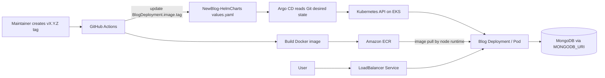

# AWS EKS DevOps Project: Node.js Blog CI/CD and GitOps

A server-rendered blog application built with Node.js, Express, EJS and MongoDB. This repository contains the application, Docker image definition and a tag-triggered GitHub Actions workflow that publishes versioned images to Amazon ECR and updates the deployment chart in [NewBlog-HelmCharts](https://github.com/alamzia23/NewBlog-HelmCharts).

The checked-in configuration describes an EKS-oriented delivery path. The repository alone does not prove that an AWS cluster or Argo CD installation is currently running.

## Architecture



GitHub Actions is currently disabled for both repositories. The workflow below describes the configured delivery path; publishing repository cleanup does not enable it.

## Delivery flow

1. Push a Git tag matching `v<major>.<minor>.<patch>` (for example `v1.2.3`). The workflow does not run on ordinary branch pushes.
2. GitHub Actions checks out the app, configures AWS credentials from repository secrets, logs in to ECR, builds the Dockerfile, and pushes the tag to the registry configured by `AWS_REGISTRY_URL`.
3. The workflow checks out `NewBlog-HelmCharts` and changes `BlogDeployment.image.tag` to the same Git tag, committing/pushing the chart change to `main` with a GitHub token.
4. Argo CD must already be configured to observe this chart repository and application. It reads the Git desired state and renders the Helm chart into Kubernetes manifests. Whether changes sync automatically depends on the Argo CD Application configuration, which is not stored here.
5. Kubernetes schedules the pod. The node’s kubelet/container runtime pulls the image named in the Deployment from ECR, subject to node role/registry permissions. Argo CD does not download or pull container images.

ECR stores the image; it does not deploy it. Helm supplies parameterized Kubernetes templates. Argo CD reconciles those rendered resources against Git. Kubernetes manages the workload and service.

## Stack and repository responsibilities

- **Application:** Node.js 18 Alpine base image, Express, EJS, Mongoose/MongoDB, sessions and JWT-related application dependencies.
- **Build and release:** Docker; GitHub Actions workflow at `.github/workflows/main.yml`; Amazon ECR.
- **Deployment definition:** Helm chart in [NewBlog-HelmCharts](https://github.com/alamzia23/NewBlog-HelmCharts); Argo CD is expected to watch that Git repository.
- **Runtime:** Kubernetes on the configured EKS target, with a `LoadBalancer` Service and one configured replica.
- **This repository:** app source, Dockerfile, and tag-triggered image publishing/chart-version update workflow.
- **Chart repository:** Deployment and Service templates, external Secret references, and image/chart values.

## Prerequisites and configuration

For the workflow, configure `AWS_ACCESS_KEY_ID`, `AWS_SECRET_ACCESS_KEY`, `AWS_REGISTRY_URL` and `TOKEN` as GitHub Actions secrets. `AWS_REGISTRY_URL` must be the complete ECR repository URI (for example `123456789012.dkr.ecr.us-east-1.amazonaws.com/blog-app`), without a tag. The workflow writes this same URI and the release tag into the chart values, keeping the image references aligned. `TOKEN` needs write access to the chart repository. AWS credentials need permission to authenticate and push to that ECR repository. The workflow uses region `us-east-1`.

For a functioning deployment, provide an EKS cluster, Argo CD Application pointed at the chart repository, EKS node image-pull access to ECR, and a reachable MongoDB database. The application requires `MONGODB_URI`, `JWT_SECRET`, and `SESSION_SECRET` environment variables. Locally, place them in an ignored `.env` file (copy `.env.example`) or export them in your shell. In Kubernetes, create the Secret named by `BlogDeployment.existingSecret` (default `my-app-secrets`) outside Helm/Git, with keys `MONGODB_URI`, `JWT_SECRET`, and `SESSION_SECRET`. Never commit actual values.

## Local use

```bash
npm ci
cp .env.example .env
npm start
```

Fill `.env` with local secret values before starting. The application listens on port `5000` by default. The package currently defines `start` as `app.js` rather than `node app.js`; if that command does not launch in your environment, use `node app.js`. The repository does not define an automated test suite (`npm test` exits with “no test specified`).

## Deploy and verify (existing infrastructure required)

1. Ensure the GitHub secrets, ECR repository, EKS cluster, Argo CD Application and database are configured as above.
2. Push a semantic version tag, such as `git tag v1.2.3 && git push origin v1.2.3`.
3. Review the Actions run and confirm the image exists in ECR and the chart repository’s `BlogDeployment.image.tag` was updated.
4. In the configured cluster, inspect Argo CD sync/health and verify rollout and Service state with `kubectl get deployment, pods, service` (use the relevant namespace).
5. Confirm the Service endpoint responds and the application can connect to MongoDB. The chart probes `/healthz` and `/live` on port `5000`.

These are verification steps, not a claim that a live deployment was tested by this documentation change.

## Current limitations

- Workflow credentials use long-lived AWS access-key secrets; OIDC is not configured. GitHub Actions are pinned to maintained major-version tags, not immutable commit SHAs.
- The image tag is updated in a separate Git repository using a personal token. No image scan, tests, signed artifacts, or release approval are configured in this workflow.
- Argo CD Application/sync policy, EKS provisioning, IAM roles, network configuration and MongoDB provisioning are outside these repositories and were not verified.
- The chart has one replica, a public-facing `LoadBalancer` Service, no resource requests/limits, autoscaling, ingress/TLS, or persistent application storage configured.
- Kubernetes credentials are externally managed and are not included in this repository. Rotate any credentials that were previously committed, including database credentials and application signing/session secrets.
- `npm test` is a placeholder that fails intentionally; no app-level test suite is included.
